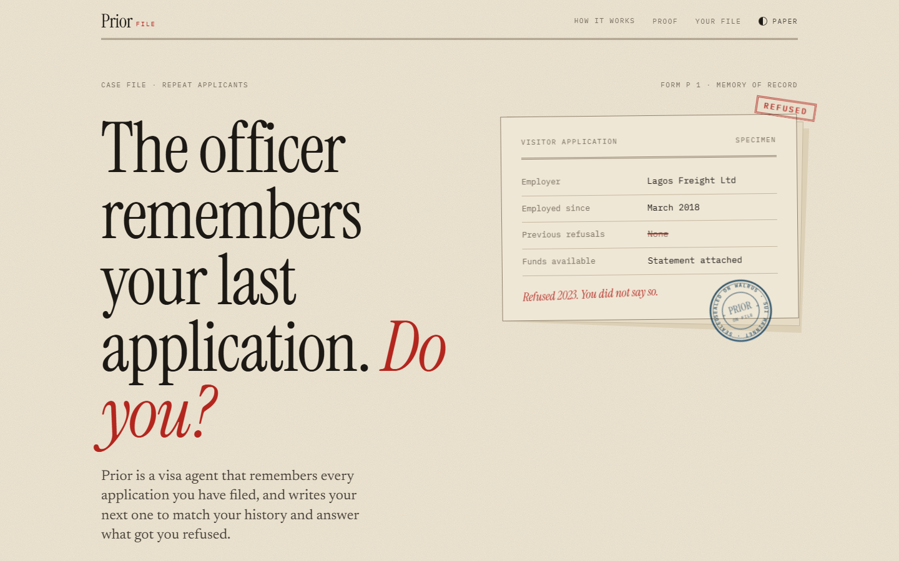
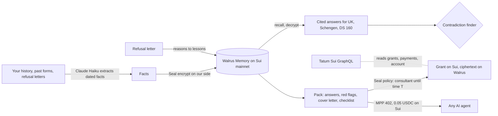

<p align="center">
  
</p>

<h1 align="center">Prior</h1>

<p align="center"><b>The officer remembers your priors. Now you do too.</b></p>

<p align="center">
  <a href="https://prior-pi.vercel.app"></a>
  
  
  
  
  
</p>

<p align="center"></p>

Prior is a visa agent that remembers every application you have ever filed: the answers you gave, the documents, the refusals and the reasons written in them. When you apply again, it writes the new application from your own record, flags every place it disagrees with what you filed before, and answers the reasons you were refused last time.

**Visa refusals are not a documents problem. They are a memory problem.** The officer has every form you ever filed. You do not.

- **1.75 million** Schengen visa applications were refused in 2025, one in every seven of about 12 million filed ([Mappr](https://www.mappr.co/?p=72448), European Commission data).
- **€130M** in Schengen fees was kept from refused applicants in 2023 alone, and a refused fee is never refunded ([Dawn](https://dawn.com/news/amp/1839140), LAGO Collective data).
- A false "No" about a past refusal on a US visa form can be treated as misrepresentation, a permanent bar ([Nolo](https://www.alllaw.com/articles/nolo/us-immigration/visa-green-card-denied-false-information-forms.html)).
- Officers cross check a new application against previous applications, travel history and employment dates ([Ahluwalia Law](https://www.ahluwalialaw.com/ai-visa-screening-consular-adjudication-2026/)). One mismatch reads as a credibility problem, and a refusal you forgot to disclose can be treated as deception.

## Judge fast path (five minutes, no keys)

1. Open **[prior-pi.vercel.app/app](https://prior-pi.vercel.app/app)**.
2. **Your history:** paste a few lines about your own jobs, trips and any past visa application, in plain words. Include one thing you once wrote differently on a form if you can ("On my 2024 France form I wrote that I started at X in 2019"). Press **Build my file**.
3. Watch each fact get **sealed on Walrus**: it is encrypted with Seal, stored on Walrus mainnet, and shows its blob id. Click one to open it on Walruscan.
4. **Your trip:** pick Schengen, UK Visitor or US DS 160 and a destination. Prior drafts every answer it can prove, each one citing the memory it came from. Contradictions with your earlier forms appear in red, with the fix.
5. **Got refused before?** Paste any refusal letter. Each reason becomes a lesson in your file, the pack is redrafted, and the before and after shows exactly what the refusal taught it.
6. **Share with a consultant:** pick a few minutes, open the link in another window, and watch access end on the Sui clock. The Seal key servers refuse the read after that.
7. **Survives us:** wipe the local index and restore the whole file from Walrus.
8. Open **[/proof](https://prior-pi.vercel.app/proof)**: every memory count, grant and payment, read live from Sui mainnet through Tatum.

## How it works



| Step | What runs |
|---|---|
| Remember | Each fact is Seal encrypted with `MemWalManual` (the relayer only makes the 1536 dim search vector) and stored on Walrus mainnet under the Walrus Memory account `0x3ffa0d1c…05aa`. |
| Recall | `recallManual` searches by meaning and decrypts with the delegate key. Every answer cites fact ids. |
| Learn | A refusal letter becomes reason codes (ties, funds, purpose, history, documents, credibility). Each becomes a lesson memory. The next pack adds the documents and the cover letter paragraph that answer it. |
| Check | A deterministic contradiction finder compares your history with what you filed before: job dates, undisclosed refusals, overlapping jobs or trips, unexplained gaps. |
| Share | `prior_share::share` (package `0x38ac8750…f81b`, immutable) holds a Grant naming one consultant and an expiry. Seal releases the key only while `clock < expires` and the grant is not revoked. |
| Sell | `GET /api/agent/pack` answers HTTP 402 with an MPP challenge; an agent pays 0.05 USDC on Sui, the method verifies the transaction onchain, and Tatum confirms it again before the result is shown. |
| Port | `mcp/server.mjs` lets Claude Code, Codex or any MCP agent read the same encrypted file with your delegate key. |

## What is real and what is not

| Part | Status |
|---|---|
| Fact extraction from plain words and refusal letters | Real, Claude Haiku, every call logged with token counts |
| Memories on Walrus mainnet | Real. Seal ciphertext only. Downloaded blobs contain none of the plaintext words (see `docs/spikes/seal-encrypted-memory.md`) |
| Contradiction finder | Real, deterministic, 13 of 13 planted contradictions caught, 0 of 7 false alarms (`docs/EVAL.md`) |
| Form question sets | Schengen fields follow the EU harmonised form. UK Visitor and DS 160 are paraphrased from the public sections; the exact wording on those sites is not published or was not reachable |
| Consultant expiry | Real Seal policy on Sui mainnet, verified in a browser: decrypts before, key servers answer 403 after |
| Agent payments | Real MPP payments in USDC on Sui mainnet, verified by the MPP method and again through Tatum before any work is done. The demo agent on the site is Prior's own wallet paying the owner wallet, for example [`GyQDgdTk…`](https://suivision.xyz/txblock/GyQDgdTkxVwoWwV17ezoDRkZ5eJ4ywqXhvLNXiEQGbX4) |
| Demo files | Live under Prior's own Walrus Memory account, one namespace per visitor with a long random file id that only your browser holds. Prior runs that account, so Prior can decrypt demo files; the public proof page shows counts, never file ids. In a personal setup the account is your own wallet |
| Legal advice | No. Prior drafts and checks. It does not submit anything anywhere |

## Track by track

- **Smart Agents for Real Life:** an agent that carries your visa history across every application and every consultant, and gets sharper with each refusal.
- **Best Walrus Memory:** the learning loop is the product. A refusal letter writes lessons into memory, and the next pack visibly changes because of them, with the lesson cited.
- **Best Use of Agent Payments:** any AI agent can buy a pack over MPP, settled in USDC on Sui, verified onchain.

## Why only here

A visa history is the most sensitive file a person owns. Walrus Memory with Seal keeps it encrypted, owned by a Sui account, lendable to a consultant for exactly as long as a Sui clock allows, and readable by any agent you choose. A normal app would hold your passport history in plain text on its own server.

## The business in one number

A refused Schengen application loses a EUR 90 fee and months of planning. A Prior pack costs an agent **0.05 USDC**.

## Proof

- Live feed: [prior-pi.vercel.app/proof](https://prior-pi.vercel.app/proof) (Sui mainnet via Tatum GraphQL, Walrus Memory relayer)
- Walrus Memory account: `0x3ffa0d1cde15d3b203c1c0b838022c3b7aa30edcdc58411ca53d1501712805aa`
- Share policy package (immutable): [`0x38ac8750…f81b`](https://suivision.xyz/package/0x38ac8750c7a00c9b4fba9a5bd86320ec67590da579a859b85eb69f5571b4f81b)
- Spikes with outputs: [`docs/spikes`](docs/spikes)
- Eval: [`docs/EVAL.md`](docs/EVAL.md)

## Run it

```bash
npm install
cp .env.example .env.local   # Tatum key, Walrus Memory account + delegate key, Anthropic key, server wallet
npm run dev
npm test                      # 27 tests
npx tsx scripts/eval.ts       # contradiction eval
```

Use a file from Claude Code (needs the delegate key of the Walrus Memory account that holds the file, so for demo files that is the operator; in your own setup it is your key):

```bash
claude mcp add prior -e MEMWAL_KEY=<delegate key> -e MEMWAL_ACCOUNT_ID=<account id> -e PRIOR_FILE=<file id> -- node mcp/server.mjs
```

## Scope and limits

- Revoking or expiring consultant access stops new reads. It cannot make anyone unsee a page they already opened.
- The relayer sees text for a moment to make the search vector, and the drafting model sees the history to write answers. Neither stores it. Walrus stores ciphertext only.
- Rate limits are per server instance, with a global cap per route.
- Revoking a share needs the token returned to the applicant who created it.

MIT licensed.
